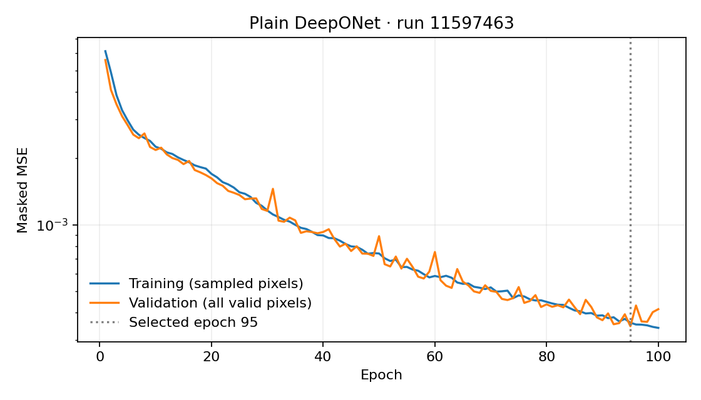

# Plain DeepONet: run 11597463

Completed on November 3, 2026, on Explorer node `c2193` with one Tesla P100-PCIE-12GB GPU. Slurm recorded `COMPLETED`, exit code `0:0`, and a wall time of 5 minutes 8 seconds.

## Results

| Metric (mean over designs) | Test: 881 designs | Extrapolation: 979 designs |
| --- | ---: | ---: |
| Relative L2 | 0.177543 | 0.183915 |
| Edge relative L2 | 0.347897 | 0.363351 |
| Gradient relative L2 | 0.870675 | 0.858674 |
| Masked MSE | 0.000343850 | 0.000347587 |

The model completed 100 epochs. Epoch 95 had the lowest validation masked MSE: **0.000346148**. Training took 216.93 seconds (0.06026 GPU-hours, excluding setup and evaluation). Warmed-up, synchronized, batch-one model inference took **0.451 ms**; this excludes data loading and preprocessing.

This is one run with seed 6180. The field error is about 18%, while edge and gradient errors remain substantially higher. These results establish the plain-coordinate baseline; they do not yet establish an advantage over the staff PCA + GP baseline or diffusion.

## Setup and evaluation

The 67,074-parameter DeepONet uses width-128 SiLU branch and trunk networks and rank 64 per output channel, without Fourier features. AdamW uses learning rate 0.001 and weight decay 0.000001. Each batch contains 16 designs and samples 1,024 valid pixels per design. Validation uses all valid pixels, with patience 15.

The fixed course splits contain 7,048 training, 881 validation, 881 test, and 979 extrapolation designs. Masked pixels are excluded from losses and metrics. The best checkpoint is selected only by validation loss; both test splits are evaluated afterward. Edge error uses a Euclidean three-pixel band around the mask. Gradient error uses forward differences on the physical coordinate grid, excluding stencils touching the mask. Metrics are per-design norms aggregated across designs; standard deviations in the JSON files describe variation across designs, not across training seeds.

## Files

- `metrics.json`: aggregate metrics, selected epoch, and timing.
- `config.json`: hyperparameters, software versions, GPU, and training-script hash.
- `history.jsonl` and `training.log`: loss history and complete program output.
- `slurm.txt`: scheduler state, exit code, runtime, and peak host memory.
- `best.pt`: selected model and optimizer checkpoint.
- `test_per_design.json` and `test_extrap_per_design.json`: individual design metrics.
- `test_examples.npz` and `test_extrap_examples.npz`: four predictions, targets, masks, and coordinate grids per split.
- `sha256sums.txt`: file checksums.

Training source and submission instructions are in [experiments/deeponet_plain](../../../experiments/deeponet_plain/). The training script hash is `32ca458eb54f3060fd9abf99625f6c7d9bf2e746b19250333d423dc3568e25b4`.
