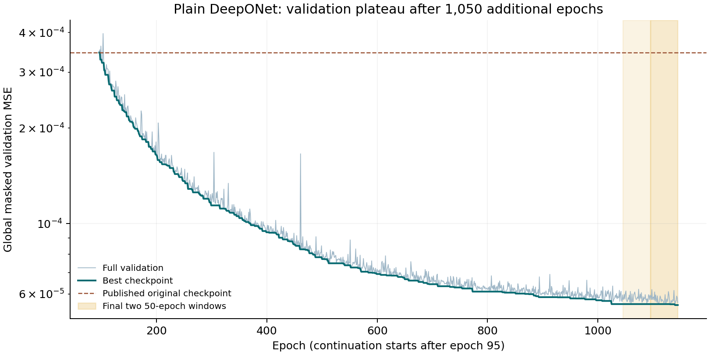
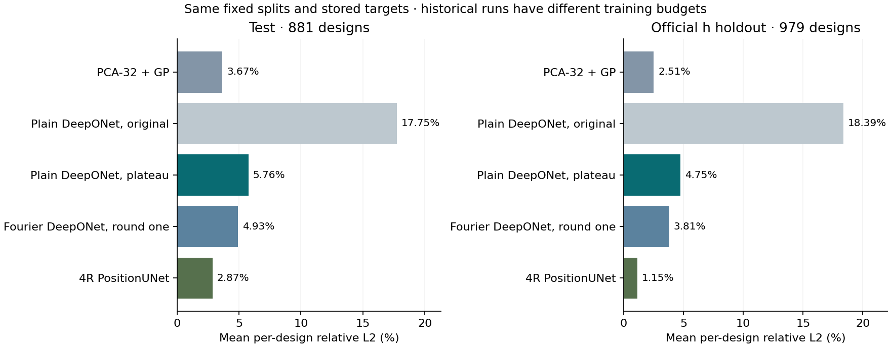
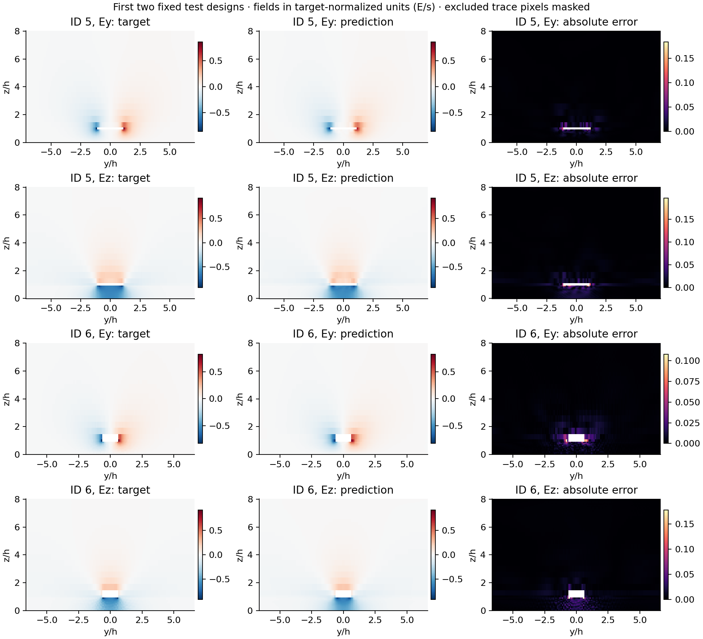

# Plain DeepONet trained to a validation plateau

Longer training reduces mean test relative L2 from **17.75% to 5.76%**. The best global validation MSE is **5.53994 × 10⁻⁵**, 6.25 times lower than the original checkpoint's 3.46148 × 10⁻⁴. This is a new continuation from the published checkpoint, not the separate-machine trial discussed by the team.

## Training and stopping

The model and AdamW state start at epoch 95 of [run 11597463](../../deeponet_plain/11597463/). Architecture, inputs, coordinates, learning rate (0.001), batch size (16), sampled valid pixels (1,024) and gradient clipping are unchanged. The historical checkpoint did not save random-generator states, so the initial continuation uses a new sampling stream seeded with 6180. Later recovery checkpoints preserve the optimizer, random states, best weights and stopping counters.

Job **11638570** completed with exit code **0:0** on a **Tesla V100-SXM2-32GB**, node `d1004`. It trained for 1,050 additional epochs in **1,597 seconds (26.62 minutes)** and stopped at epoch **1145**. The selected checkpoint is from epoch **1140**. The scheduler's full elapsed time, including loading and evaluation, was 27 minutes 44 seconds.

The predeclared rule stops after two consecutive, non-overlapping 50-epoch windows with less than 1% improvement in best full-validation MSE. The final windows improved by **0.000%** (epochs 1045–1095) and **0.704%** (1095–1145). There was no scientific epoch cap. This is an operational plateau for the fixed optimizer and learning rate, not evidence of a global optimum. Test scores did not affect stopping or checkpoint selection.

## Held-out results

Values are mean per-design relative L2 over valid pixels; lower is better. The official fixed splits and stored targets are unchanged.

| Method | Test (881 designs) | Official h holdout (979 designs) |
|---|---:|---:|
| PCA-32 + GP | 3.67% | 2.51% |
| Plain DeepONet, original | 17.75% | 18.39% |
| **Plain DeepONet, plateau** | **5.76%** | **4.75%** |
| Fourier DeepONet, round one | 4.93% | 3.81% |
| 4R PositionUNet | 2.87% | 1.15% |

The continuation removes much of the original training-budget gap. It still has higher field error than PCA+GP, the round-one Fourier model and 4R on both splits. Its test edge and gradient relative L2 are **10.10%** and **50.83%**; those details remain in the metrics rather than being reduced to one field-error average.

Historical methods have different training budgets and hardware. The original plain run used a P100; this continuation used a V100. No training-speed or inference-latency ratio is inferred from that hardware change. This is one continuation with one sampling seed, not an independent-seed study. All accuracy scores are against the stored normalized targets, not a converged Palace reference.

## Fixed examples

The figure uses the first two test rows, IDs 5 and 6; the example archive retains the first four. Targets use the dataset's joint peak-vector-field scale. Predictions have not been independently renormalized. Each target/prediction pair shares a color scale, and excluded trace pixels are masked.

## Verification and artifacts

The [audit](validation.json) checks the dataset, original source, continuation source and initial checkpoint hashes; all fixed split IDs and sample IDs; every per-design aggregate; masks, truth and coordinate grids; and all plateau counters in the 1,050-record history. The best checkpoint was reproduced on CPU for **all 881 validation, 881 test and 979 holdout designs**. Every reported held-out per-design metric matched within the stated numerical tolerance. The largest example prediction difference was **3.34 × 10⁻⁶**. Example truth, masks and grids match the original HDF5 exactly.

- [Metrics](metrics.json), [method comparison](comparison.csv), [history](history.jsonl), [configuration](config.json), [final status](status.json)
- [Best checkpoint](best.pt), [test records](test_per_design.json), [holdout records](test_extrap_per_design.json), [test examples](test_examples.npz), [holdout examples](test_extrap_examples.npz)
- [Runtime provenance](provenance.json), [training log](plain-plateau-11638570.log), [scheduler record](slurm.txt), [checksums](sha256sums.txt)
- [Training protocol and source](../../../experiments/deeponet_plateau/), [reproduction audit](../../../experiments/deeponet_plateau/audit_results.py), [figure generation](../../../experiments/deeponet_plateau/build_report.py)

The raw configuration retains the original job's top-level hostname and job ID. The start log and provenance identify the actual continuation as job 11638570 on d1004; raw artifacts are preserved unchanged. Optimizer recovery files remain on HPC and in the local full archive and are excluded from this report directory.
