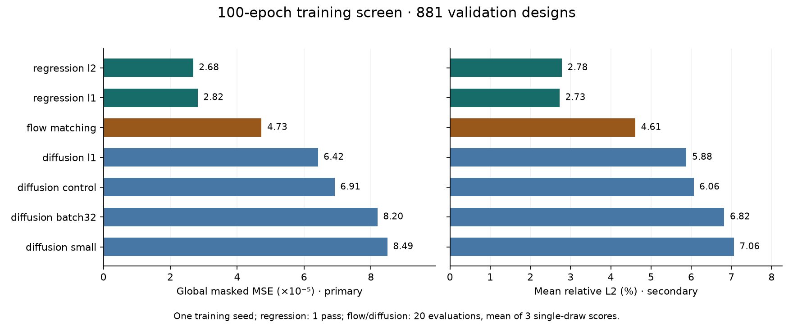
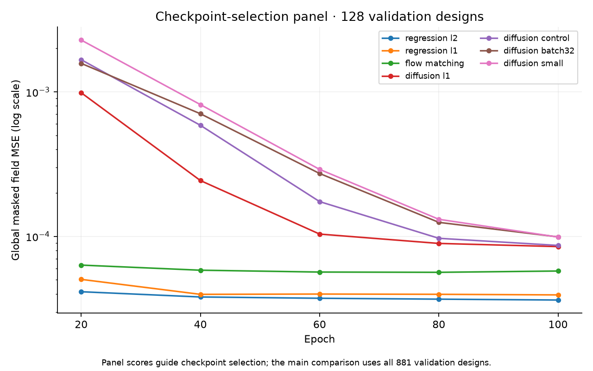
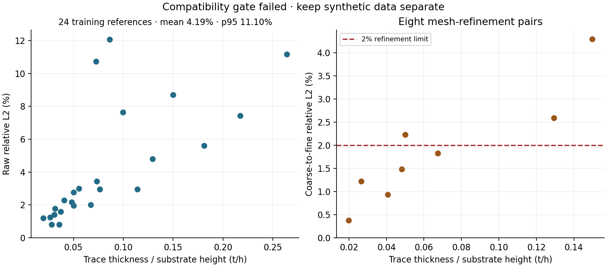
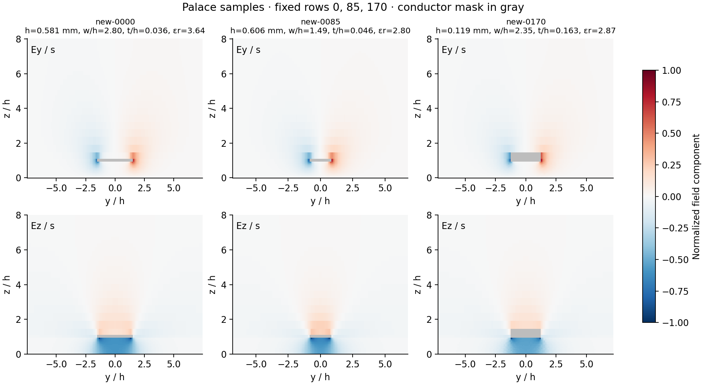

# Feedback campaign: validation audit and new experiments

The campaign is complete: seven 100-epoch training variants were evaluated, and Palace generated 256 new designs plus 32 reference/refinement cases. Regression leads the validation screen; flow matching outperforms the diffusion control at 20 network evaluations. The Palace dataset passed integrity checks but failed the prespecified compatibility gate, so it remains separate from course training. The [experiment protocol](../../../experiments/feedback_round4/) maps the meeting feedback to these tests.

## Training screen

Slurm array **11811956** completed all seven runs; report job **11811957** completed afterward. Each run used training seed 6180 and 100 passes through the original training split. Checkpoint selection used global masked field MSE on a fixed 128-design validation panel. The selected checkpoints were then scored on all 881 validation designs.

| Variant | Global masked MSE (primary) | Relative L2 | Network evaluations | Selected epoch |
|---|---:|---:|---:|---:|
| regression-l2 | 2.683217e-05 | 2.784% | 1 | 100 |
| regression-l1 | 2.818730e-05 | 2.728% | 1 | 100 |
| flow-matching | 4.728336e-05 | 4.611% | 20 | 80 |
| diffusion-l1 | 6.415357e-05 | 5.882% | 20 | 100 |
| diffusion-control | 6.913678e-05 | 6.063% | 20 | 100 |
| diffusion-batch32 | 8.195836e-05 | 6.823% | 20 | 100 |
| diffusion-small | 8.492290e-05 | 7.064% | 20 | 100 |

Rows are ordered by the prespecified global MSE metric. Regression-L2 leads on that metric, while regression-L1 has the lowest mean relative L2. Flow and diffusion scores average three single-draw errors (sampling seeds 6180–6182); they do not average predicted fields. Regression uses one forward pass.

The smaller diffusion model and batch-32 setting did not improve this screen. Batch 32 receives 22,100 optimizer updates versus 44,100 for batch 16, so this tests equal example exposure rather than equal update count. Diffusion-L1 improves field MSE modestly, but its gradient relative L2 rises to 0.630 from the control's 0.479. It is not an improvement across all metrics.

These are single-training-seed, 100-epoch results. They do not establish convergence, performance at the 500-epoch Round 3 budget, or held-out generalization. Six variants selected their final epoch. A full-budget, multi-seed comparison of the diffusion control, flow matching, and regression is the next confirmation candidate; it has not been submitted. New synthetic data must first pass the separate compatibility gate before an augmentation experiment.

See the [summary](screen-report/summary.json), [20/50/100-step results](screen-report/validation.csv), [run histories and per-design errors](screen/), and [figure source](build_figures.py). Forty-seven downloaded evidence files matched their HPC SHA256 hashes. Checkpoint hashes were checked on HPC, and the per-design averages were recomputed locally; predictions were not recomputed locally. See [transfer verification](screen-transfer-verification.json), [checkpoint and completion checks](screen-verification.json), and [file hashes](screen-evidence-sha256.json).

## Validation audit

Job **11811898** evaluated the completed Round 3 cosine checkpoint (`20cf28fcba91cec7626793139e2342c92326523ec491d992393af53cf4ad2430`). All 881 validation designs were scored at each sampling budget using seeds 6180–6182. These are averages of single-draw errors, not an ensemble of fields.

| DDIM network evaluations | Relative L2 | Global masked MSE | Evaluation wall time |
|---:|---:|---:|---:|
| 20 | 4.874% | 5.747883e-5 | 51.6 s |
| 50 | 5.036% | 6.145003e-5 | 118.3 s |
| 100 | 5.094% | 6.282015e-5 | 229.5 s |

The 20- and 50-step scores reproduce the previous evaluation. Increasing to 100 steps did not improve this checkpoint. Timings include evaluation and metric work on the allocated GPU; they are not a dedicated single-design latency benchmark.

On a 16-design validation panel:

- Replacing target tensors left sampled predictions unchanged.
- Changing inference batch size from 16 to 4 changed the largest output element by only 4.77e-7.
- Reversing row order preserved predictions within the stated numerical tolerance.
- Independent NumPy global masked MSE was 5.7439651003e-5, versus 5.7439651622e-5 from the prior helper.
- A zero predictor had relative L2 of 1.0. Shuffling predictions across designs increased mean relative L2 from 4.51% to 40.40%.

These checks found no target dependence or metric-aggregation error in the audited path. They do not prove every possible validation issue is absent. The prior noise-loss diagnostic uses fixed randomness and EMA weights, which can make its curve smooth; its RNG stream also depends on batching, so it is unsuitable for comparing noise loss across batch-size settings. Field sampling uses sample-ID-keyed randomness.

See [checks](validation-audit/checks.json), [metrics](validation-audit/validation.json), and per-design files in [validation-audit](validation-audit/).

## Preflight

GPU preflight **11811854** passed six numerical tests and all seven end-to-end smoke runs. These smoke scores are not performance results. Capacity job **11811929** completed a base-36, batch-32 forward/backward/optimizer step with peak allocated GPU memory of 2,762,168,320 bytes.

## Palace generation

All **288 simulations** completed: 256 new Latin-hypercube designs, 24 training reference designs, and eight refined reference meshes. The first 18-case pilot passed verification before the remaining 15 shards ran, with at most four tasks in parallel. Generation jobs were **11819206** and **11819558**; verification and packing job **11819947** completed successfully.

The packed `palace-pilot.h5` contains 256 two-channel fields of shape **2 × 64 × 128**, masks, design parameters, coordinates, and normalization scales. It is 15,351,547 bytes and remains in the campaign's scratch directory with the raw simulation artifacts. Its checksum is recorded in [completion metadata](palace/complete.json). The original course dataset and splits were not changed.

Every case passed checksum, shape, finite-field, mask-zero, E/s normalization, coordinate, input-identity, and solver-artifact checks. All 288 PCG solves converged and logged the intended ground/trace Dirichlet conditions and one terminal excitation. All 256 packed rows matched their verified sample files. See [case verification](palace/all-case-verification.json) and [dataset verification](palace/dataset-verification.json).

### Compatibility gate

| Check | Observed | Limit | Result |
|---|---:|---:|---|
| Mean reference relative L2 | 4.188% | ≤ 5% | Pass |
| Reference p95 relative L2 | 11.097% | ≤ 10% | Fail |
| Maximum coarse/refined relative L2 | 4.294% | ≤ 2% | Fail |

**This dataset is not eligible for augmentation under the declared protocol.** The gate used raw errors, without fitted scaling or discarded pixels. Three of the eight refinement pairs exceeded 2%. All eight selected refined meshes reduced their error against the corresponding course reference, but this does not establish mesh convergence or compatibility across all designs. Additional mesh and reconstruction checks are needed before mixing these fields into course training.

The [gate record](palace/quality-gate.json) and [per-reference/refinement CSV](palace/reference-and-refinement.csv) provide the underlying values. References came only from the training split. This is an inferred reconstruction, not the original staff generation pipeline.

### Generated examples and provenance

These previews use fixed dataset rows 0, 85, and 170, independently of error scores. Each component shares a fixed [-1, 1] color scale; masked conductor pixels are gray.

The [case manifest](palace/cases.json) records the design inputs. The geometric mask rule matched all 7,048 original training designs before generation. The [runtime summary](palace/runtime/summary.json) records public versions, source commits, and check outcomes; raw environment records remain private. [Build status](palace/build-status.json) records the build and setup history. The early boundary warning in the solver logs was reviewed: actual solves impose ground 3 and trace 4, while outer boundary 5 retains the reconstruction's natural boundary condition.

Seven final evidence files matched their HPC SHA256 values, and nine generating/reporting source files matched the local repository. Figures were visually reviewed. See [transfer verification](palace/final-transfer-verification.json), [source and artifact hashes](palace/evidence-sha256.json), and [report code](../../../experiments/feedback_round4/report_palace.py). The packed HDF5 was verified on HPC; it was not downloaded or published to GitHub.

The [submission record](screen-submission.json) records the GPU array and its preconditions. Thirteen downloaded evidence files matched SHA256 values calculated on HPC; see [verification](verification.json) and the original [hash mapping](evidence-sha256.json). The [source manifest](microstrip-feedback-manifest.json) identifies the submitted experiment source snapshot. Build-recovery scripts added after the initial submission are tracked separately in the experiment folder.
