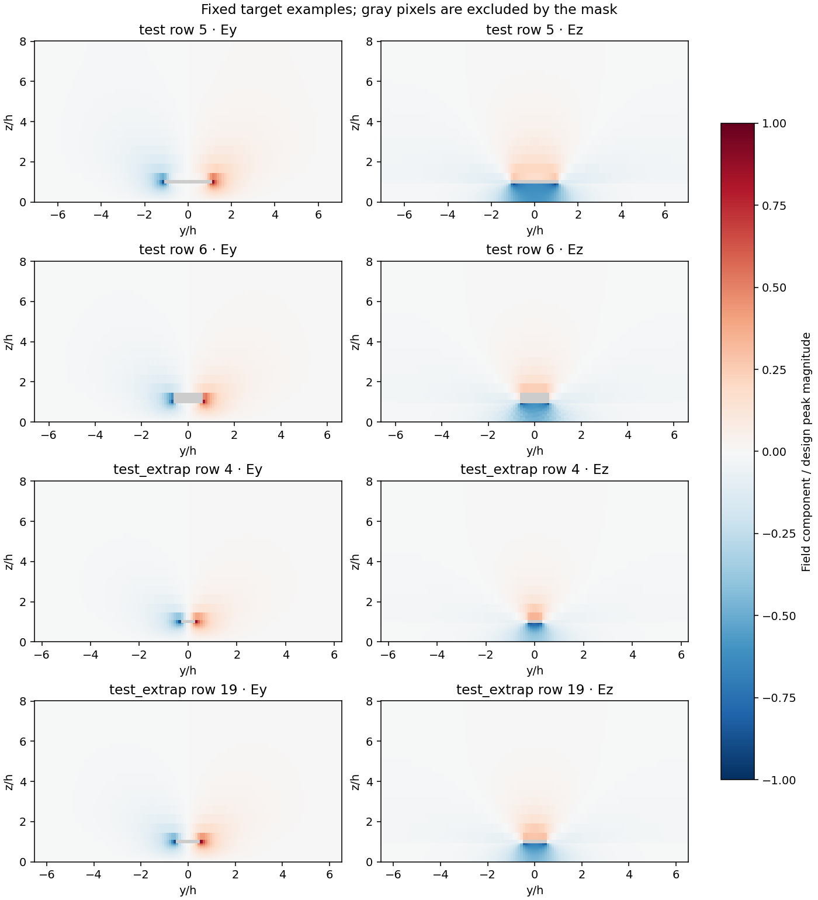
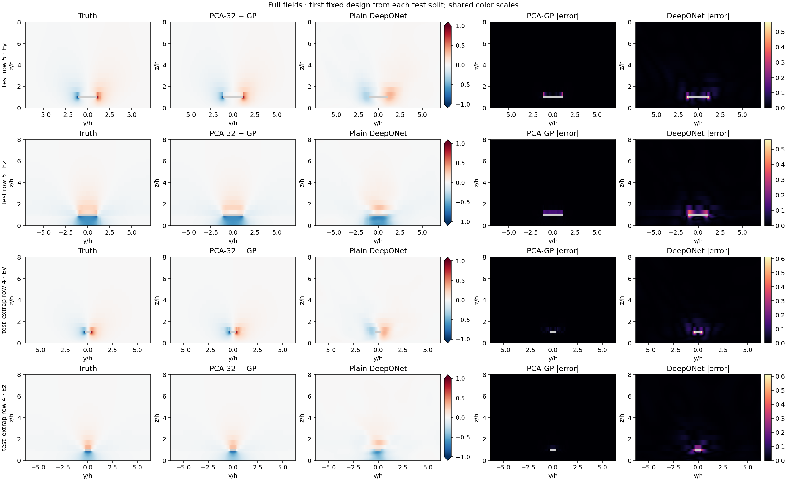
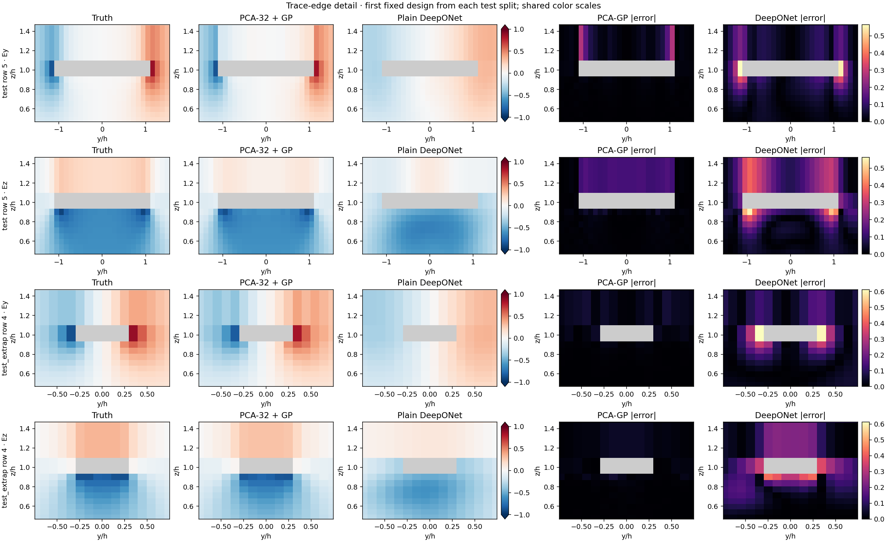

# Experiment 1: PCA-32 + Gaussian-process baseline

Explorer job **11601747** completed successfully on `c0584` with eight CPUs and no GPU. The staff baseline uses 32 PCA components and 32 independent Gaussian processes. All fitting uses the fixed training split only.

## Comparison with Experiment 2

Metrics below use the same implementation for both models. Values are means over designs; lower is better.

| Split | Model | Relative L2 | Edge relative L2 | Gradient relative L2 | Masked MSE |
| --- | --- | ---: | ---: | ---: | ---: |
| Test (881) | Staff PCA-32 + GP | 0.036664 | 0.068894 | 0.398231 | 0.000026819 |
| Test (881) | Plain DeepONet | 0.177543 | 0.347897 | 0.870675 | 0.000343850 |
| Extrapolation (979) | Staff PCA-32 + GP | 0.025133 | 0.051985 | 0.250591 | 0.000007462 |
| Extrapolation (979) | Plain DeepONet | 0.183915 | 0.363351 | 0.858674 | 0.000347587 |

The staff fitting and evaluation pipeline took **1442.8 seconds**, excluding the wrapper's initial data audit. This is a single run: staff seed 0 and DeepONet seed 6180. There is no estimate of variation across training seeds. Standard deviations in the JSON files describe variation across designs.

## Timing

| Model | Hardware | Warmed-up batch-one prediction |
| --- | --- | ---: |
| PCA-32 + GP | 8 CPUs on c0584 | 224.092 ms |
| Plain DeepONet | Tesla P100-PCIE-12GB | 0.451 ms |

Both timings exclude file I/O. PCA-GP timing includes GP prediction and PCA reconstruction; DeepONet timing covers its model forward pass. Hardware differs, so these timings are not a controlled comparison of algorithm speed. The staff batch timings are retained separately in `staff-results.json`.

## Dataset inspection

`data-inspection.json` records shapes, split counts and hashes, finite-value checks, zero masked targets, and coordinate ordering. Fixed split sizes are 7,048 training, 881 validation, 881 test, and 979 extrapolation. The mask excludes 6–72 pixels per design. Field magnitude peaks are normalized to approximately 1. The horizontal grid varies with design; derivatives use each design's actual coordinates.

## Field and trace-edge comparison

The figures use the first design in each fixed test split, selected before inspecting model errors. Field scales and error scales are shared between models. Gray pixels are masked.

## Metric conventions

`metrics.json` matches DeepONet run 11597463: valid pixels only; a Euclidean three-pixel edge band; forward derivatives divided by the actual y/h and z/h spacing; valid endpoints for derivative stencils; and per-design aggregation.

The unmodified staff script uses Chebyshev edge bands and pixel-index gradients. Its original results, PCA reconstruction floors at 8/16/32/64 components, fitted kernel descriptions, and kNN sanity check are preserved in `staff-results.json`. Do not mix those edge or gradient values with the comparison table. PCA “floor” scores are oracle reconstruction diagnostics obtained by projecting known target fields. With masking and derivative metrics, they need not be strict lower bounds.

Some optimized kernels reached the staff search bounds. Those settings were retained; the convergence warnings are recorded in `training.log`.

## Reproduction and artifacts

See [Experiment 1 source](../../../experiments/pca_gp/) and [Experiment 2 results](../../deeponet_plain/11597463/). `config.json` records software versions, source hashes, seed, and fit scope. `training.log` and `slurm.txt` record execution and scheduler status. Per-design JSON files and the first four predictions, targets, masks, and grids are retained for each evaluation split. `sha256sums.txt` covers every artifact in this directory.

Run `python build_report.py` from this directory to regenerate the report and figures. NumPy and Matplotlib are required; the Experiment 2 result files must remain at their repository paths.

The staff source is preserved byte for byte, with SHA-256 `4cf231c86d4270a0a3a6662655e094eabef5d5a409982b183920026a83ae6014`. The wrapper adds observation and reporting without changing PCA, GP fitting, or predictions.
