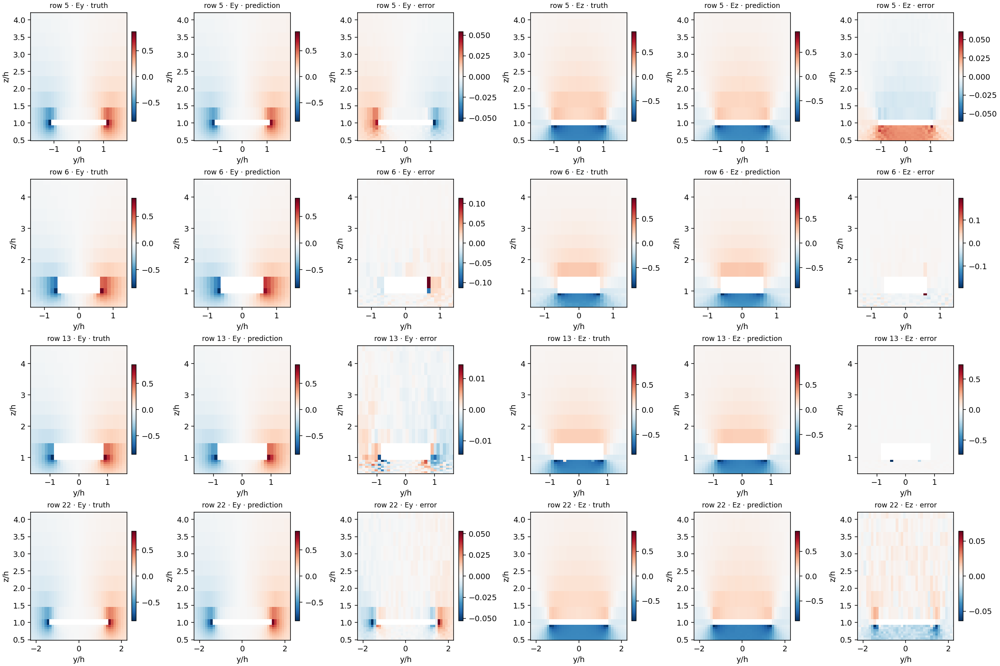

# Experiments 3–6: Fourier features and conditional diffusion

HPC job: `11603443`. GPU: Tesla V100-SXM2-32GB. All figures use the first four designs in each fixed split.

## Accuracy

Entries are mean per-design errors; lower is better. Diffusion single-sample entries average the three seed-specific means. Ensemble entries average three fields before scoring.

| Model | Split | Relative L2 | Edge L2 | Gradient error | Masked MSE |
|---|---|---:|---:|---:|---:|
| PCA32 + GP | test | 0.03666 | 0.06889 | 0.39823 | 2.68193e-05 |
| PCA32 + GP | test_extrap | 0.02513 | 0.05199 | 0.25059 | 7.46164e-06 |
| Plain DeepONet | test | 0.17754 | 0.34790 | 0.87067 | 0.00034385 |
| Plain DeepONet | test_extrap | 0.18392 | 0.36335 | 0.85867 | 0.000347587 |
| Fourier DeepONet | test | 0.04931 | 0.07823 | 0.41925 | 4.03391e-05 |
| Fourier DeepONet | test_extrap | 0.03810 | 0.05950 | 0.27341 | 1.79147e-05 |
| Direct DDIM-20 (selected), one draw | test | 0.06322 | 0.07676 | 0.73858 | 7.58225e-05 |
| Direct DDIM-20 (selected), three-draw mean | test | 0.04950 | 0.06241 | 0.57817 | 4.83334e-05 |
| Direct DDIM-20 (selected), one draw | test_extrap | 0.04476 | 0.04284 | 0.57261 | 3.4192e-05 |
| Direct DDIM-20 (selected), three-draw mean | test_extrap | 0.03278 | 0.03206 | 0.43404 | 1.94281e-05 |
| Direct DDIM-50, one draw | test | 0.06389 | 0.07939 | 0.67507 | 7.96404e-05 |
| Direct DDIM-50, three-draw mean | test | 0.05018 | 0.06430 | 0.53057 | 5.08407e-05 |
| Direct DDIM-50, one draw | test_extrap | 0.04438 | 0.04421 | 0.48572 | 3.46908e-05 |
| Direct DDIM-50, three-draw mean | test_extrap | 0.03279 | 0.03322 | 0.36982 | 2.03743e-05 |
| Residual DDIM-20, one draw | test | 0.08155 | 0.07076 | 0.48140 | 9.5682e-05 |
| Residual DDIM-20, three-draw mean | test | 0.05585 | 0.05721 | 0.40270 | 4.98972e-05 |
| Residual DDIM-20, one draw | test_extrap | 0.06722 | 0.03473 | 0.24425 | 6.02635e-05 |
| Residual DDIM-20, three-draw mean | test_extrap | 0.04173 | 0.02501 | 0.19910 | 2.32277e-05 |
| Residual DDIM-50 (selected), one draw | test | 0.07992 | 0.07119 | 0.48755 | 9.26448e-05 |
| Residual DDIM-50 (selected), three-draw mean | test | 0.05505 | 0.05753 | 0.40520 | 4.89785e-05 |
| Residual DDIM-50 (selected), one draw | test_extrap | 0.06505 | 0.03455 | 0.24626 | 5.66026e-05 |
| Residual DDIM-50 (selected), three-draw mean | test_extrap | 0.04059 | 0.02497 | 0.19943 | 2.20996e-05 |

## Selection and compute

Fourier scale 2.0 was selected by validation masked MSE. The frozen regression comparator is the fourier model. Fourier search training and validation took 8.44 minutes across all three scales.

| Model | Parameters | Training + validation hours | Best epoch | Stop reason | Selected DDIM steps | One draw, model-only seconds | Three draws, model-only seconds |
|---|---:|---:|---:|---|---:|---:|---:|
| Direct diffusion | 5,601,674 | 1.233 | 200 | epochs | 20 | 0.136487 | 0.409460 |
| Residual diffusion | 5,602,322 | 1.241 | 200 | epochs | 50 | 0.370862 | 1.112587 |

The frozen regressor takes 0.000396 seconds per design in its recorded timing. Residual sampling times above use cached conditioning; add one regression prediction for a new design. Training times include validation and checkpoint selection, but exclude data loading, frozen-prediction caching, and final DDIM evaluation. GPU hours describe the allocated GPU, not active-kernel time. PCA+GP timing used a CPU and should not be read as a hardware-matched speed comparison.

A two-hour training-budget stop is a budgeted comparison, not evidence that diffusion has converged. Learning curves and validation scores are retained for this distinction.

## Artifacts

- `direct-results.zip` and `residual-results.zip`: complete structured outputs, including configurations, histories, per-design metrics for every draw and ensemble, fixed examples, sampler selection, and stage logs.
- `best-direct.pt` and `best-residual.pt`: selected EMA checkpoints.
- `metrics-direct.json`, `metrics-residual.json`, and `comparison.csv`: machine-readable comparisons.
- `fourier-11603443.zip` and `fourier-metrics.json`: the previously published full Fourier stage, including the frozen comparator.
- `figures.zip`: all fixed-example field and error figures, including both sampling step counts and edge zooms.
- `validation.json` and `sha256sums.txt`: data/metric/source checks, checkpoint replay, transfer records, and publication checksums. Optimizer recovery files remain on HPC.

The direct and residual figures score the mean of three fields, while the primary single-draw errors average three independent scores. The metric definitions and constraints are documented in the source README.

## Interpretation

The fixed-split field and edge errors do not support paying the sampling cost for diffusion in this comparison. The matched deterministic U-Net in Experiment 4R is more accurate than the direct and residual diffusion variants, including their three-draw averages. Residual diffusion does improve extrapolation gradient error slightly when averaging three draws. The two-hour limit constrained the position-paired diffusion run, and only one training seed was used; these results do not establish that diffusion is intrinsically inferior.

[Matched 4R comparison and complete cross-model table](../../unet_regression/11604740/).
