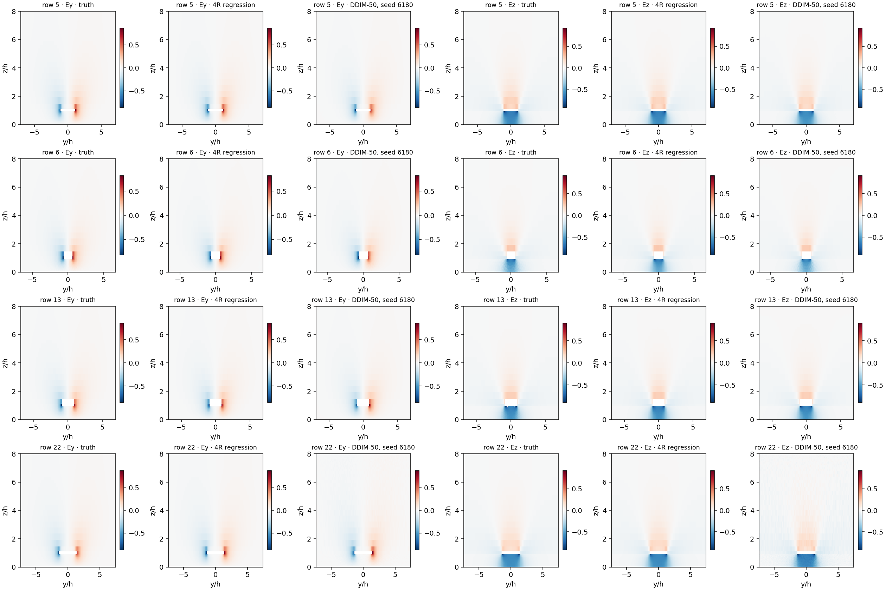
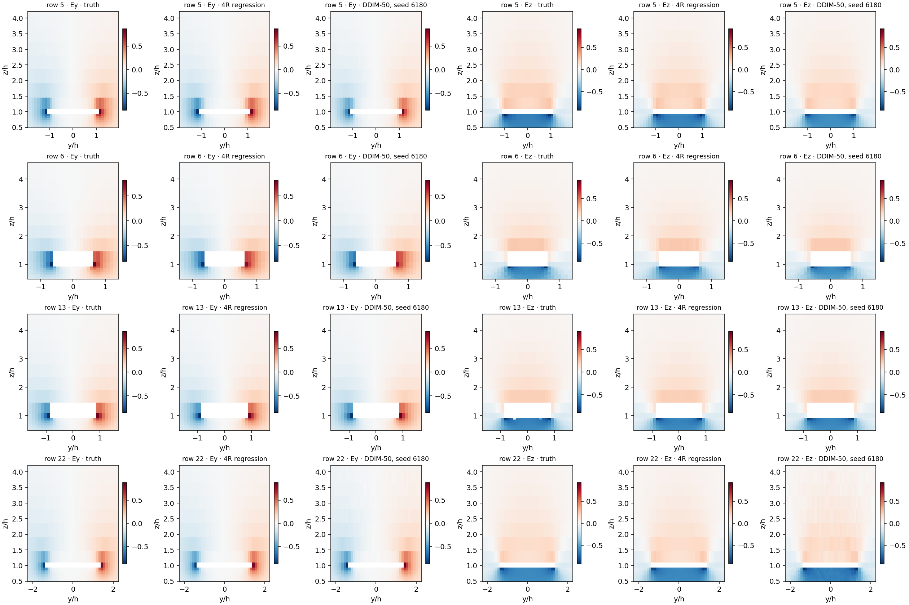
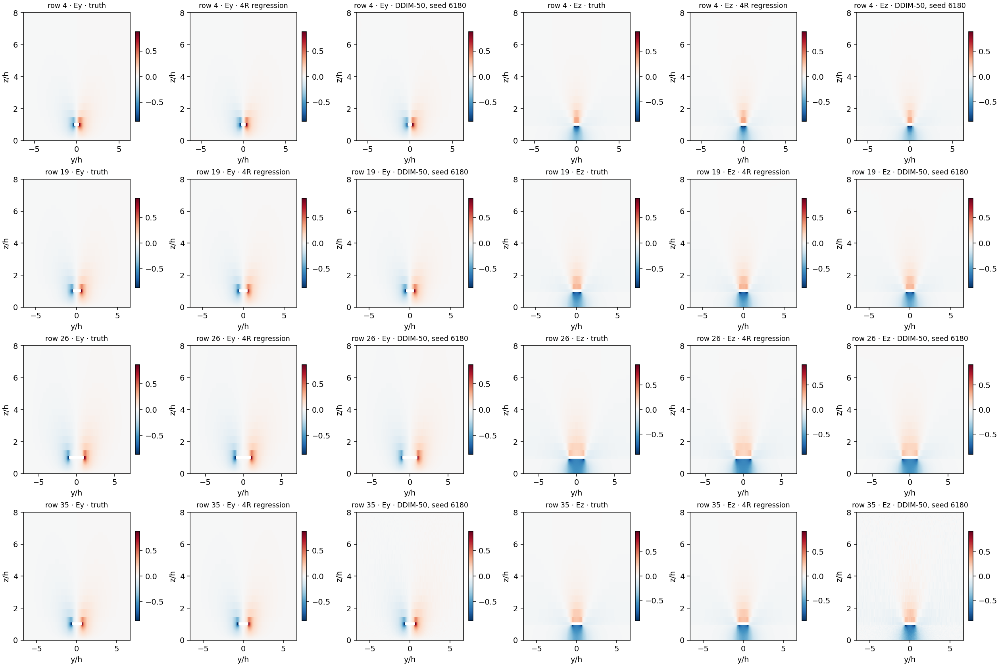
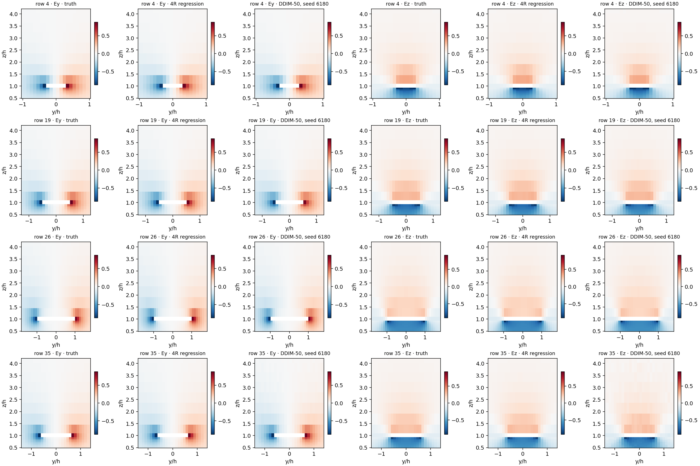
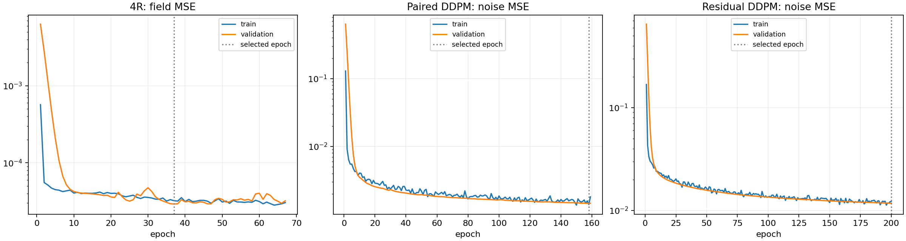

# Experiment 4R and matched conditional diffusion

Deterministic U-Net regression was more accurate than its matched diffusion control on both held-out splits and required one forward pass. This result applies to the recorded architectures, training budgets, and single training seed.

## Matched comparison

| Model | Test relative L2 | Extrapolation relative L2 | Test edge L2 | Extrapolation edge L2 |
|---|---:|---:|---:|---:|
| 4R U-Net | 2.87% | 1.15% | 4.46% | 1.50% |
| DDIM single draw | 7.56% | 5.81% | 8.45% | 4.97% |
| DDIM three-draw mean | 5.71% | 4.13% | 6.76% | 3.66% |

Both networks have 5,602,322 parameters and ran sequentially on the same Tesla P100-PCIE-12GB in job `11604740`. Actual initialization hashes match: `df1aadd4588324c5d3b041c76b139f5cad2a910beaac70ee8ceb9775d29ed090`. Both receive the same four design parameters and fixed row/column index planes. 4R uses zero field inputs and time zero; the diffusion model receives the noised field and its timestep.

Validation selected 50 DDIM steps. Single-draw errors average the results for seeds 6180, 6181, and 6182; ensemble errors score the mean of those three fields. Both 20- and 50-step settings, all seeds, and sample variation are retained in the raw outputs.

## Compute and selection

| Model | Training + validation | Last recorded epoch / best | Stop reason | Batch-one prediction |
|---|---:|---:|---|---:|
| 4R | 0.854 GPU-hours | 67 / 37 | early_stopping | 10.01 ms |
| Paired DDPM / DDIM-50 | 2.001 GPU-hours | 159 / 158 | training_budget | 585.95 ms per draw |

On the same GPU, a diffusion draw cost 58.6 times as much as the deterministic prediction; a three-draw average cost about 175.7 times as much. Timing uses batch size one, CUDA synchronization, warmups, and repeated calls. It excludes data loading. Training times include validation and checkpoint selection; allocated job wall time including evaluation was 3:04:47.

4R selected its EMA checkpoint by validation field MSE and stopped after 30 epochs without improvement. Diffusion selected its EMA checkpoint by fixed-seed validation noise MSE and reached its two-hour training limit. The final diffusion epoch was cut short at the time limit. Equal maximum budgets do not imply equal training durations or convergence. The paired diffusion result should therefore be read as a budgeted comparison, not a claim that further training cannot improve it.

Targets use means and standard deviations fitted on valid training pixels only. 4R minimizes masked MSE in peak-normalized field units; diffusion minimizes masked noise MSE. Both enforce the known component range [-1,1] at evaluation and zero masked outputs. The recorded clipped and unclipped 4R errors are identical.

## Relation to the other experiments

The PCA-32 + GP baseline scored 3.67% / 2.51% relative L2 on test / extrapolation, compared with 2.87% / 1.15% for 4R. Among the recorded models, 4R has the lowest overall field and edge errors on both splits. Residual diffusion with three draws has slightly lower extrapolation gradient error (0.1994 versus 0.2175), while its field and edge errors remain higher.

The original direct diffusion and residual runs used a V100 and no fixed position planes; they remain separate results. Only the position-conditioned DDPM in this job is the matched backbone control for 4R. Cross-model CPU/GPU timing comparisons are not hardware matched. No test targets were used for model or sampler selection.

## Fixed examples

The figures use the first four designs in each fixed split. The diffusion images show seed 6180 at the validation-selected step count; examples were not chosen by error. White cells are excluded trace pixels. Each truth/regression/diffusion group shares its color scale. The full archive also contains prediction-minus-truth figures and all saved example draws.

## Files

- `regression-metrics.json`, `diffusion-metrics.json`, and `comparison.csv`: machine-readable results.
- `regression-results.zip` and `diffusion-results.zip`: full structured outputs, including configurations, histories, per-design metrics, fixed examples, sampler selection, and logs.
- `best-regression.pt` and `best-diffusion.pt`: the selected EMA checkpoints.
- `pair-config.json`, `validation.json`, `provenance.json`, and `sha256sums.txt`: pairing, audit, transfer provenance, and file checksums.
- `figures.zip`: all detailed field/error plots. Optimizer recovery checkpoints remain on HPC.

[Source and reproduction protocol](../../../experiments/unet_regression/) · [Original diffusion experiments](../../remaining/11603443/)
